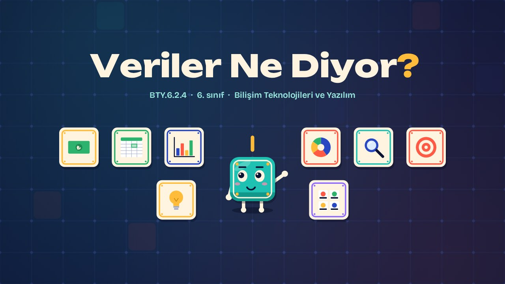
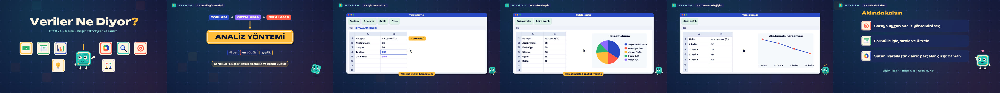

# Veriler Ne Diyor? · What Does the Data Say?

**▶ Tarayıcıda izleyin / Watch in the browser:** https://hakanatas.github.io/veriler-ne-diyor/ 
**⬇ MP4 + altyazılar / MP4 + subtitles:** [Releases](https://github.com/hakanatas/veriler-ne-diyor/releases) 
**✎ Kullanılan istem / The prompt behind it:** [PROMPT.md](PROMPT.md) 
**🎞 Bütün filmler / All films:** [Bilişim Filmleri](https://hakanatas.github.io/bilisim-filmleri/?sinif=6)

> **TR —** 6. sınıf Bilişim Teknolojileri ve Yazılım dersinin "Dijital Ürün Tasarımı ve Geliştirme" temasındaki BTY.6.2.4 öğrenme çıktısı için hazırlanmış, tamamen JavaScript ile çizilen 2,1 dakikalık animasyon; ses efektleri ve hafif fon müziği de kodla üretilir. Karo'nun bir aylık harcama verileriyle "En çok neye para harcadım?" sorusunun cevabı aranır. Soruya uygun analiz yöntemleri (toplam, ortalama, sıralama, filtre) seçilir. Veriler =TOPLA ve =ORTALAMA formülleriyle işlenir; aralık için ":" kullanımı gösterilir. Veriler sıralanıp filtrelenerek analiz edilir. Son olarak veriler sütun, daire ve çizgi grafikle görselleştirilir ve hangi grafiğin ne zaman kullanılacağı açıklanır. Altyazılar Türkçe, İngilizce ya da ikisi birlikte seçilebilir.

A 2.1-minute animation, with code-generated sound, for **6th-grade IT and Software** (Türkiye Yüzyılı Maarif Modeli). With a month of spending data, Karo picks suitable methods (sum, average, sort, filter), processes the data with SUM and AVERAGE formulas, analyses it by sorting and filtering, and visualises it with bar, pie and line charts. The guide is **Karo**, a living glazed tile who never speaks: he tells the story with his face, his arms and the blinking cursor above his head.

## Öğrenme çıktısı · Learning outcome

MEB, Türkiye Yüzyılı Maarif Modeli, Bilişim Teknolojileri ve Yazılım Dersi Öğretim Programı, 6. sınıf, 2. tema "Dijital Ürün Tasarımı ve Geliştirme":

**BTY.6.2.4. Tablolama programları kullanarak bulgulara ulaşabilme**
- a) Bulgulara ulaşmak için uygun analiz yöntemlerini seçer.
- b) Tablolama programları kullanarak verileri işler.
- c) Tablolama programları kullanarak verileri analiz eder.
- ç) Tablolama programları kullanarak verileri görselleştirir.

## Sahneler · Scenes

| # | Zaman | Sahne | Ne oluyor | Çıktı |
|---|---|---|---|---|
| 1 | 0:00–0:16 | Giriş |  |  |
| 2 | 0:16–0:45 | Analiz yöntemleri | Soruya uygun analiz yöntemini seçmek. | a |
| 3 | 0:45–1:15 | İşle ve analiz et | TOPLA ve ORTALAMA formülleri, sıralama ve filtre. | b, c |
| 4 | 1:15–1:32 | Görselleştir | Sütun ve daire grafik. | ç |
| 5 | 1:32–1:49 | Zamanla değişim | Çizgi grafik. | ç |
| 6 | 1:49–2:05 | Aklında kalsın |  |  |

## Çalıştırma · Running it

- **Önizleme:** `index.html` dosyasına çift tıklayın (çevrim dışı da çalışır). Klavye: boşluk oynat/duraklat, ← → 3 sn, Home başa. Adrese `?altyazi=en`, `?bicim=vertical` ya da `?ses=0` eklenebilir.
- **MP4:** bir kez `npm install`, sonra `npm run export -- --format=both --captions=tr` (720p yatay ve dikey, sesli). Google Chrome yüklüyse Playwright onu kullanır (`channel: 'chrome'`); ffmpeg gerekir.
- **Altyazı ve seslendirme notları:** `npm run srt` → `out/veriler-ne-diyor_tr.srt`, `_en.srt`, `_tr-en.srt`, `_seslendirme-notlari.txt`.
- **Sürüm dosyaları:** `npm run release` → `release/` klasöründe v1.0'ın 6 dosyası.
- **Yazı kontrolü:** `npm run check` yatay ve dikey düzende, üç altyazı seçeneğiyle üst üste binen, kenardan taşan ya da 720p'de 17 pikselden küçük kalan yazı arar.
- **Düzenleme:** senaryo (sahneler, altyazılar, seslendirme notları) `scenes/film.js` içindedir; değiştirince `npm run build` süreleri, `captions.js` ve `film.config.js` dosyalarını yeniden üretir. Sahne şablonları `src/kit/`, Karo `src/draw/karo.js`, ses `src/audio/synth.js`.

Her kare `renderFrame(t)` ile zamanın saf fonksiyonu olarak çizilir; rastgelelik tohumludur, MP4 ekran kaydı değil kare kare üretimdir. Ses de dosyadan çalınmaz: aynı olay listesinden hesaplanır. Yazı tipleri: Unbounded ve Bricolage Grotesque (SIL OFL 1.1), dosyaya gömülü.

## Lisans · License

**TR —** Bu film ve kodu [Creative Commons Atıf-GayriTicari 4.0 Uluslararası (CC BY-NC 4.0)](https://creativecommons.org/licenses/by-nc/4.0/deed.tr) lisansıyla paylaşılır. Ticari olmayan her amaçla (derste, okulda, eğitim materyalinde) kopyalayabilir, paylaşabilir ve değiştirebilirsiniz; ancak **kaynak göstermek zorunludur**: eser sahibinin adı ve bu deponun bağlantısı belirtilmeden kullanılamaz. Ticari kullanım (satış, ücretli ürün ya da yayın) için izin alınmalıdır.

**EN —** This film and its code are licensed under [Creative Commons Attribution-NonCommercial 4.0 International (CC BY-NC 4.0)](https://creativecommons.org/licenses/by-nc/4.0/). You may copy, share and adapt them for non-commercial purposes, but **attribution is required**: they may not be used without crediting the author and linking to this repository. Commercial use requires permission.

Atıf örneği / Required credit: *“Veriler Ne Diyor?”, Hakan Ataş, Bilişim Filmleri — https://github.com/hakanatas/veriler-ne-diyor — CC BY-NC 4.0*
